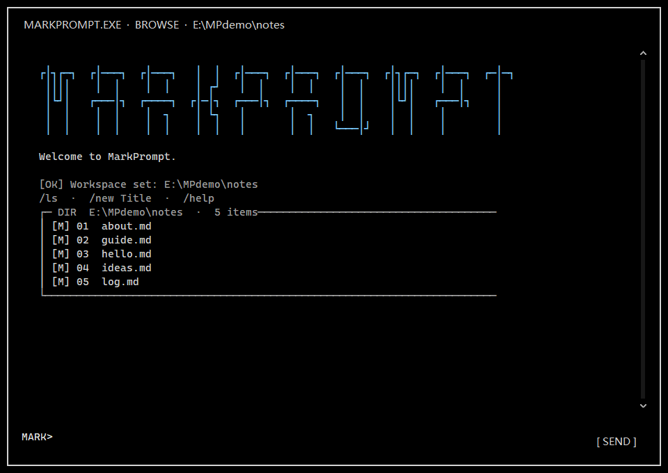
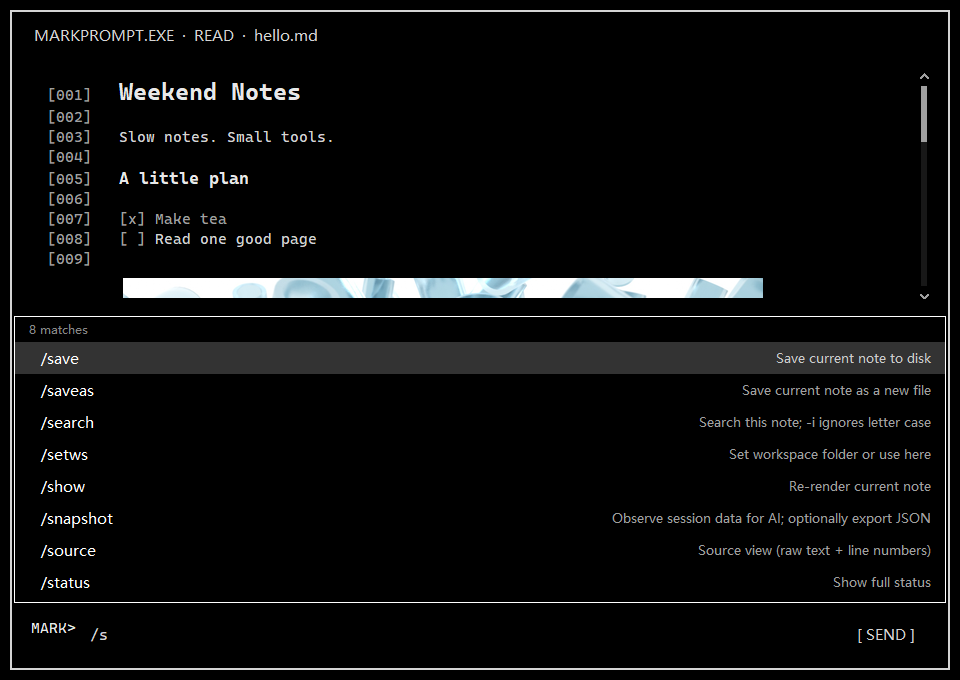
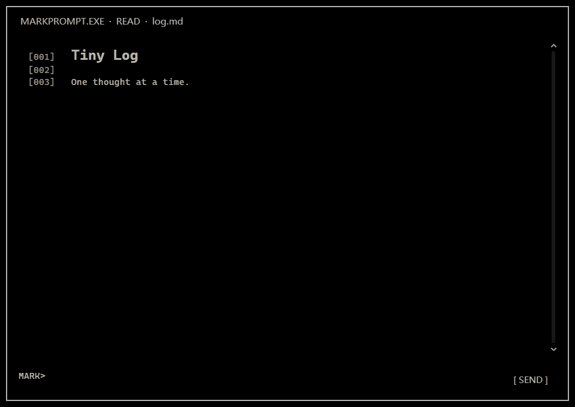
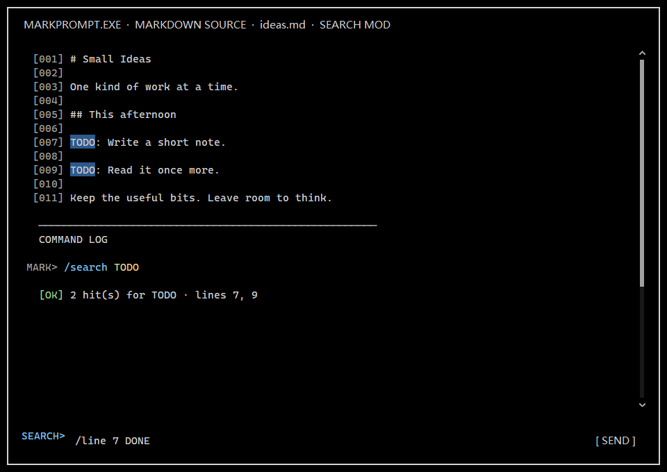
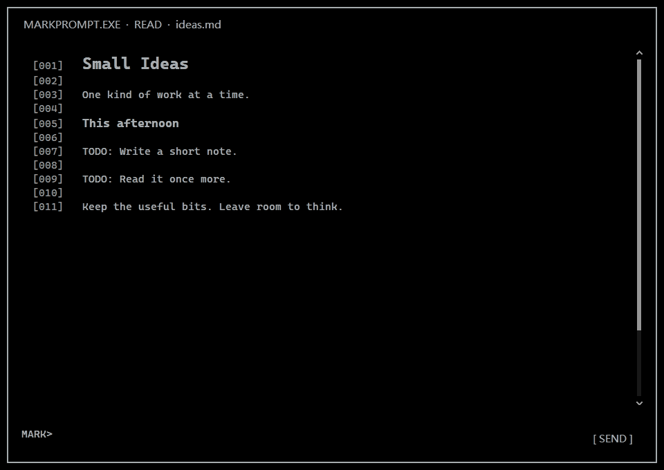
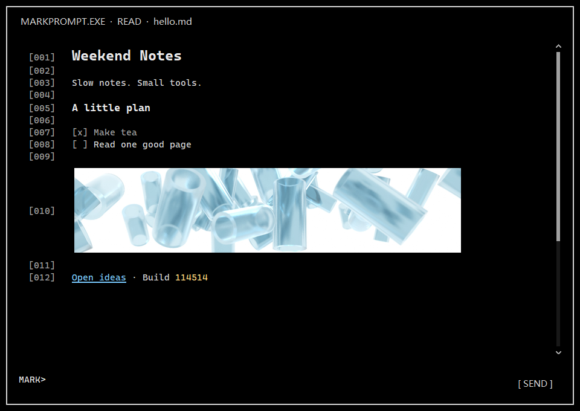
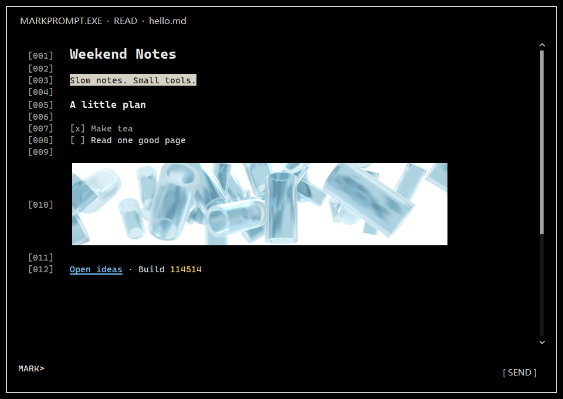
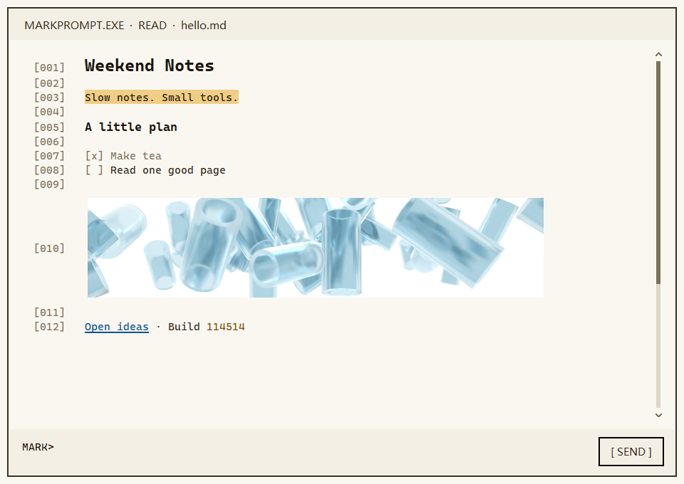

# 📖 MarkPrompt

> *A little DOS-era fun for your Markdown.*

🌐 [简体中文](README.md) | **English**


[](LICENSE)
[](https://github.com/4044044044)

[✨ Features](#features) · [📦 Install](#start) · [🚀 Start](#quickstart) · [📖 Examples](#tutorials) · [📋 Commands](#commands) · [🤖 CLI](#cli) · [🔨 Build](#build)

---

<a id="features"></a>

## ✨ Features

A small local Markdown tool with a soft spot for DOS: a text-based interface, a command prompt, and plenty of keyboard controls. Read, jot down ideas, or let the CLI and AI join in.

- 📖 **Drop and read** — open Markdown, text files, or folders.
- ✍️ **Edit with commands** — append, edit lines, replace, undo, and redo.
- 🔎 **Find your notes** — search filenames, workspace content, or the current document.
- 🗂️ **Keep things together** — workspaces, bookmarks, tags, tasks, and archives.
- 🖼️ **Local images** — display PNG, JPG, and JPEG in Markdown, in their original colors.
- 🌗 **Make yourself at home** — dark / light themes and Chinese / English UI.
- 🤖 **Bring your scripts** — standalone CLI, live window control, and JSON snapshots.

Native Tkinter UI. `.md` files support command-based editing; `.txt` files are read-only. Common Markdown syntax is supported, with partial extension support. Remote images are not loaded. Binary or unsupported files show `Unknown`.



---

<a id="start"></a>

## 📦 Install

### 🪟 Windows portable edition

1. Download `MarkPrompt-2026.11.01-publish1-windows-x64.zip` from the release assets.
2. Extract it and double-click **`MarkPrompt.exe`**.
3. For terminal use, run **`MarkPromptCLI.exe`**.

No Python installation is required. Keep the included third-party notices alongside the application.

### 🐍 Run from source

Open a terminal in this README's directory, install dependencies, then launch:

```powershell
py -m pip install -r requirements.txt
py markprompt.py
```

On Windows, you can also double-click `markprompt.py` after installing dependencies. Use the same Python environment for installation and launch.

🧰 Requires Python, Tkinter, Pillow, and tkinterdnd2. Verified on Windows / Python 3.9.10; other systems have not been tested on-device. Replace `py` with your environment's `python` or `python3` where needed.

---

<a id="quickstart"></a>

## 🚀 Quick start

Drop your notes folder into the window, then enter:

```text
/workspace here
/new Hello
/append My first note in MarkPrompt.
/save
```

🎉 Your folder is now the workspace, and `Hello.md` has its first entry.

Dropping a folder opens it; `/workspace here` makes it your notes workspace. Text edits stay in memory until you `/save`.

### ⌨️ Keyboard shortcuts

| Key | Action |
| --- | --- |
| `/` | Focus command input |
| `Enter` | Submit input |
| `Tab` | Complete a command |
| `↑` / `↓` | Navigate suggestions; scroll with empty input and no text selection |
| `Ctrl + P` | Find a filename |
| `Ctrl + F` | Search this note |
| `Ctrl + O` | Show outline |
| `F3` / `Shift + F3` | Next / previous hit |
| `Ctrl + S` | Save |
| `Ctrl + Z` / `Ctrl + Y` | Undo / redo |

💡 Type `/s` to see matching commands and their descriptions.



---

<a id="tutorials"></a>

## 📖 Examples

### ✍️ Example 1: Keep writing

Open a Markdown file, enter `/append`, then submit your notes one at a time:

```text
/append
First idea
Second idea
/end
/save
```

💡 `/append text` appends once; `/append` enters continuous capture. `/end` leaves the current mode without saving.



### 🔎 Example 2: Find a note or a keyword

| Looking for | Example |
| --- | --- |
| A filename containing meeting | `/files meeting` |
| Workspace notes mentioning deadline | `/find deadline` |
| todo in the current note | `/search todo` |
| Case-insensitive todo in this note | `/search -i todo` |

📂 Use `/find` from a directory view; leave a document with `/back` first. Opening a matching file starts in-note search at a hit. `/back` restores the workspace results and position.



### 🛠️ Example 3: Edit what you found

Suppose line 12 reads `API_A calls API_B`:

```text
/search API
/line 12 service
/save
/end
```

That line becomes `service_A calls service_B`; other lines are unchanged.

| Action | Normal reading | During search |
| --- | --- | --- |
| `/line 12 text` | Replace the whole line | Replace hits on that line |
| `/line delete 12` | Delete the whole line | Delete hits on that line |
| `/line 12` | Jump to line 12 | Limit search to that line |
| `/replace text` | Search first | Replace all hits in scope |
| `/delete` | Search first | Delete all hits in scope |

💾 Save, undo, and redo preserve search mode. Start `/search keyword` again to search the whole note. Leave search with `/end` before appending. Each in-note search takes one keyword.

🎬 Find TODO, change the hit on line 7 to DONE, then save. The other hit stays in place.



### 🖼️ Example 4: Add a local image

Image paths are relative to the Markdown file:

```text
notes/
├── Hello.md
└── images/
    └── photo.jpg
```

Inside `Hello.md`:

```markdown

[Visit a website](https://example.com)
```

Images retain their original colors. Use `/external links` to list document links, then `/external link N` to open a link on source line N.

🧊 The glass artwork is an original work by the project author, cropped to fit the demo.



---

<a id="appearance"></a>

## 🌗 Two moods, one notebook

Dark for a little DOS nostalgia; light for a warm paper feel. Text selection is paper-white in dark mode and amber in light mode.

| 🌑 Dark | ☀️ Light |
| --- | --- |
|  |  |

---

<a id="commands"></a>

## 📋 Command reference

Type commands in the bottom input. `<…>` means required, `[…]` means optional; omit the brackets when typing. `N` is a number.

### 📂 Files & folders

| Command | Description |
| --- | --- |
| `/open [target]` | Open a path, list number, or bookmark; no argument enters OPEN mode |
| `/workspace <folder\|here>` | Set the notes workspace |
| `/ls [folder]` | List a directory |
| `/cd <folder>` | Change directory |
| `/up` | Go up one directory |
| `/tree` | Show a two-level directory tree |
| `/back` | Return to the previous view or search results |
| `/home` | Go home |
| `/pwd` | Show the current directory |
| `/files [name]` | Filter filenames |
| `/recent [name]` | List recent files |
| `/bookmark [add name [folder]\|list\|remove name]` | Add, list, or remove folder bookmarks |
| `/new <title>` | Create a Markdown note in the workspace |
| `/jot <title>` | Create a note and start capture |
| `/import <path.md>` | Copy a Markdown file into the workspace |
| `/saveas <name>` | Save a copy under a new name |
| `/export txt` | Export current text as a text file |
| `/archive` | Save and move to the workspace archive |
| `/trash` | Save and move to the workspace trash |
| `/restore <name>` | Restore from the workspace trash |
| `/reveal` | Open the containing folder in the file manager |

🧭 **Folder keywords**

| Input | Meaning |
| --- | --- |
| `/open desktop` | Desktop |
| `/open workspace` or `/open ws` | Workspace root |
| `/open @name` | A named folder bookmark |
| `/open 3` | Item 3 in the current list |
| `/workspace here` | Make the current directory the workspace |
| `/cd ..` | Parent directory |

`desktop` is an `/open` keyword. To use it as your workspace, run `/open desktop`, then `/workspace here`. For other folders, enter a path.

### ✍️ Editing & reading

| Command | Description |
| --- | --- |
| `/append [text]` | Append once, or enter continuous capture |
| `/line <N> [text]` | Jump to or edit a line; search mode edits hits only |
| `/line delete <N>` | Delete a line; search mode deletes hits only |
| `/title <title>` | Change the top-level heading in the text |
| `/save` | Save edits |
| `/undo` | Undo |
| `/redo` | Redo |
| `/preview` | Render the preview again |
| `/source` | View Markdown source |
| `/view` | Toggle preview and source |
| `/outline [N]` | List headings or jump to a heading |
| `/reload` | Reload the file or directory |
| `/external [file\|links\|link N [index]\|open target]` | Open the file or a link with a system app; defaults to the file |

💡 `/title` changes the heading; use `/saveas` to save under another filename. Source view is for reading; editing uses commands.

### 🔎 Search & organize

| Command | Description |
| --- | --- |
| `/find <keyword>` | Search workspace content, ignoring case |
| `/search [-i] [keyword]` | Search this note; `-i` ignores case; no keyword enters SEARCH mode |
| `/next` | Next hit |
| `/prev` | Previous hit |
| `/replace <text>` | Replace all hits in the current scope |
| `/delete` | Delete all hits in the current scope |
| `/tasks` | List open tasks in the workspace |
| `/check <N>` | Toggle task N in this note; N is a task index, not a line number |
| `/tag [add tags\|find tag]` | View, add, or find tags; separate added tags with commas |
| `/tags` | List workspace tags and counts |

### ⚙️ Modes & settings

| Command | Description |
| --- | --- |
| `/end` | Leave one mode and resume its parent |
| `/status` | Show file, workspace, and mode status |
| `/lang [zh\|en]` | Show or switch the UI language |
| `/theme [dark\|light]` | Show or switch the theme |
| `/dark` | Dark theme |
| `/light` | Light theme |
| `/animation [on\|off]` | Show or toggle animation |
| `/clear` | Clear command history while keeping the document |
| `/snapshot [--full] [file.json]` | Inspect session data or export JSON; `--full` includes full text |
| `/help` | Show command help |
| `/quit` | Quit |

🔁 **Continuous modes**: `OPEN>` opens repeatedly, `FIND>` searches the workspace, `SEARCH>` searches a note, and `APPEND>` captures text. Modes have at most two layers: `FIND → OPEN` or `OPEN → APPEND`. `/end` leaves one layer.

✅ **Confirmation prompts**: Choose `save`, `discard`, or `cancel`; use `y` / `n` for overwrite confirmation. Creating, importing, exporting, archiving, and moving to trash involve disk operations directly.

⚡ **Aliases**: `/ws` → `/workspace`, `/bm` → `/bookmark`, `/grep` → `/find`, `/show` → `/preview`, `/?` → `/help`. `/setws` defaults to the current directory; `/fsearch word` means `/search -i word`; `/linedel N` means `/line delete N`. Legacy `/ext` lists links with no argument, opens a link by line number, or opens another supplied target.

---

<a id="cli"></a>

## 🤖 CLI & AI

### 🧪 Run without a window

Replace `C:\Notes` with your notes folder. Multiple `-c` arguments share one session; save edits explicitly.

```powershell
# List commands and capabilities
py markprompt_cli.py commands --json

# Read a note and its structured snapshot
py markprompt_cli.py exec --workspace "C:\Notes" --file "C:\Notes\Hello.md" -c "/snapshot --full" --json

# Append and save
py markprompt_cli.py exec --workspace "C:\Notes" --file "C:\Notes\Hello.md" -c "/append Added from CLI." -c "/save" --json

# Keep an interactive session
py markprompt_cli.py shell --workspace "C:\Notes"
```

📜 For batch work, write one command per line in `workflow.txt`, then run `py markprompt_cli.py run --workspace "C:\Notes" --script workflow.txt --json`. Check `commands --json` for each command's CLI capabilities.

### 🪟 Connect to a running window

```powershell
py markprompt_cli.py gui windows --json
py markprompt_cli.py gui snapshot --full --json
py markprompt_cli.py gui exec -c "/status" --json
```

With multiple windows, add `--window WINDOW_ID`. Snapshots expose document, mode, search, and pending-confirmation data for AI. `--full` includes document text; review it before sharing.

When confirmation is required, read its ID from the snapshot and use `gui respond --confirmation ID save --json`, or choose `discard`, `cancel`, `y`, or `n` as appropriate.

📘 More details (in Chinese): [CLI](docs/cli.md) · [AI snapshots](docs/snapshots.md) · [Window control](docs/window-control.md)

---

<a id="build"></a>

## 🔨 Build executables

Run these Windows PowerShell examples from the repository root. Use a dedicated virtual environment; executables go into `dist/` and temporary build files into `build/`.

### ① 🧰 Prepare

```powershell
py -m venv .venv
$buildPython = (Resolve-Path .venv/Scripts/python.exe).Path
$sourceDir = (Get-Location).Path
& $buildPython -m pip install --upgrade pip
& $buildPython -m pip install -r requirements.txt
& $buildPython -m pip install pyinstaller==6.22.3
```

### ② 🖥️ GUI

```powershell
& $buildPython -m PyInstaller --clean --onefile --windowed --name MarkPrompt `
  --paths "$sourceDir" --icon "$sourceDir/MarkPrompt.ico" `
  --add-data "$sourceDir/MarkPrompt.ico:." --add-data "$sourceDir/MarkPrompt.png:." `
  --distpath dist --workpath build/gui --specpath build/spec `
  "$sourceDir/markprompt.py"
```

### ③ ⌨️ CLI

```powershell
& $buildPython -m PyInstaller --clean --onefile --console --name MarkPromptCLI `
  --paths "$sourceDir" --icon "$sourceDir/MarkPrompt.ico" `
  --distpath dist --workpath build/cli --specpath build/spec `
  "$sourceDir/markprompt_cli.py"
```

🎁 Output: `dist/MarkPrompt.exe` and `MarkPromptCLI.exe`.

`--onefile` bundles the runtime and dependencies, so executables are larger than the source. The CLI keeps its console for input and JSON output. Build on each target operating system; see the [PyInstaller documentation](https://pyinstaller.org/en/stable/usage.html).

### ④ ✅ Before distributing

- 🧪 Launch the built GUI and check file / folder drops, local PNG / JPG, search, editing, and saving.
- 🤖 Run `MarkPromptCLI.exe commands --json`, then check note reading and live snapshots.
- 🔐 Leave personal `markprompt.json` and notes out of the release; settings are created during use.
- 📄 Include the [third-party notices](docs/third-party-licenses/README.md) and the applicable Python, Tcl/Tk, and packaging-runtime license notices.

📌 The Windows x64 executables have passed local startup, PNG/JPG display, search/edit/save, and live CLI-control checks. Builds for other platforms need their own verification.

---

<a id="license"></a>

## 📄 Licensing & third-party components

🧊 The source code and original sample artwork supplied by the project author are released under the [MIT License](LICENSE). Copyright © 2026 MarkPrompt contributors. [Author profile](https://github.com/4044044044). Third-party components retain their own licenses.

| Component | Version | Purpose | License |
| --- | --- | --- | --- |
| Pillow | 11.3.0 | Decode local PNG and JPG images | MIT-CMU |
| tkinterdnd2 | 0.7.0 | File and folder drag and drop | MIT |

📦 Install dependencies from [requirements.txt](requirements.txt). Full copyright and license texts, including notes for native TkDND components, are in [third-party notices](docs/third-party-licenses/README.md). Third-party components retain their own licenses.

GitHub can detect dependencies from the manifest; license notices are supplied with the project. Source users install dependencies from the manifest. Executable distributions must also include the notices applicable to the components actually bundled.

---

## 🛠️ Troubleshooting

| Issue | Try this |
| --- | --- |
| Double-click does nothing | Run `py markprompt.py` in a terminal to see errors; check that dependencies use the same Python environment |
| Drops do nothing | Check tkinterdnd2; on Windows, use matching privileges for the app and Explorer |
| An image is missing | Check the relative path, file existence, and supported local format: PNG, JPG, or JPEG |
| Edits are not on disk | Run `/save` and check its result |
| Unsure which mode is active | Run `/status`; use `/end` to leave one mode at a time |

---

📷 All demos use fictional notes in `E:\MPdemo` and an isolated configuration. Screenshots show only the app content.

🗓️ Updated: **2026-11-01**

*Made with ⌨️ by [MarkPrompt contributors](https://github.com/4044044044)*
