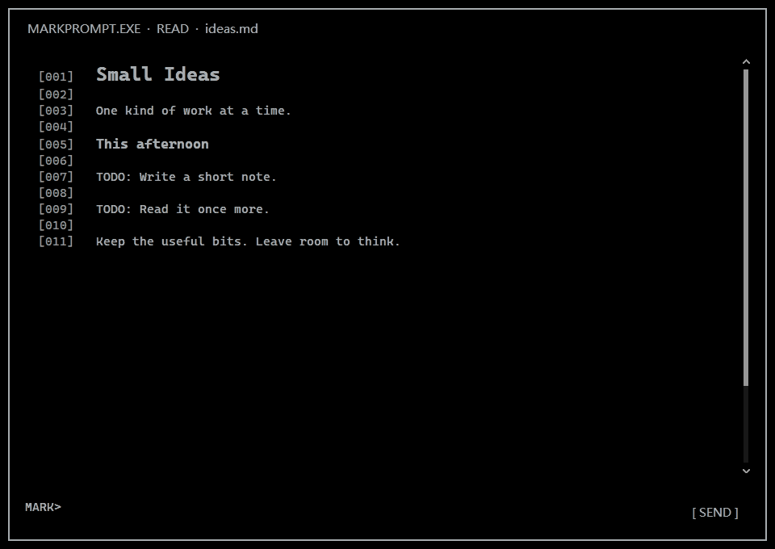
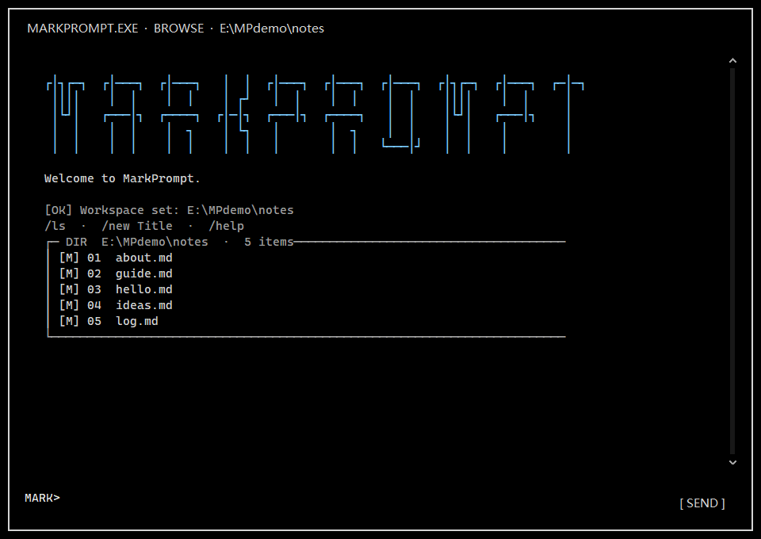
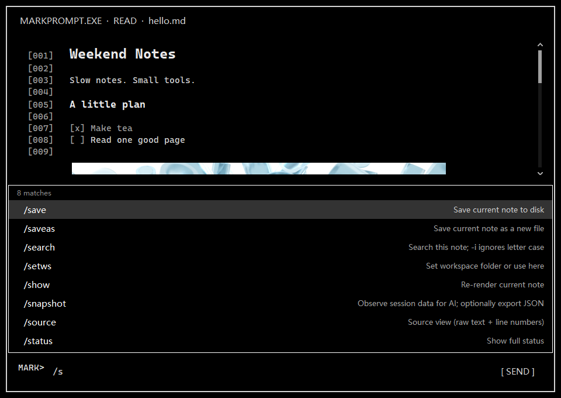
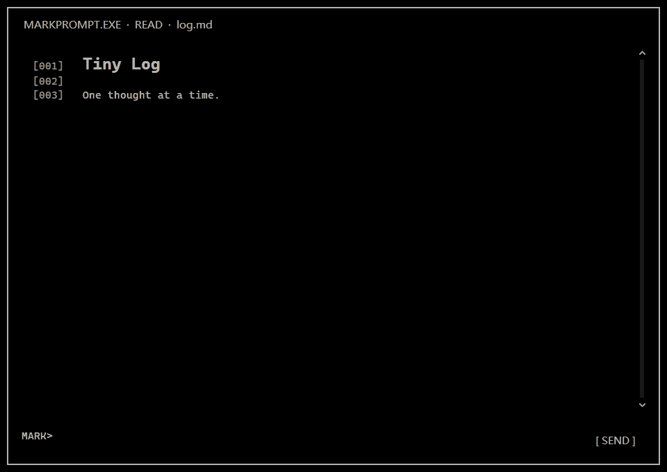
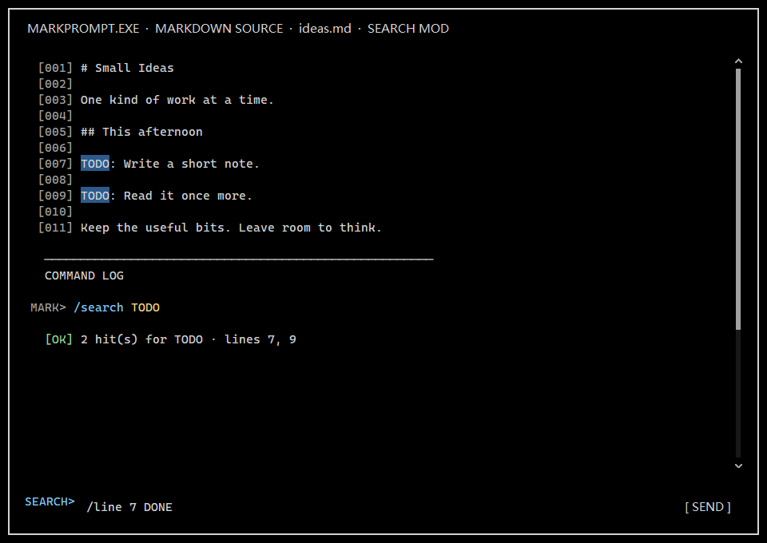
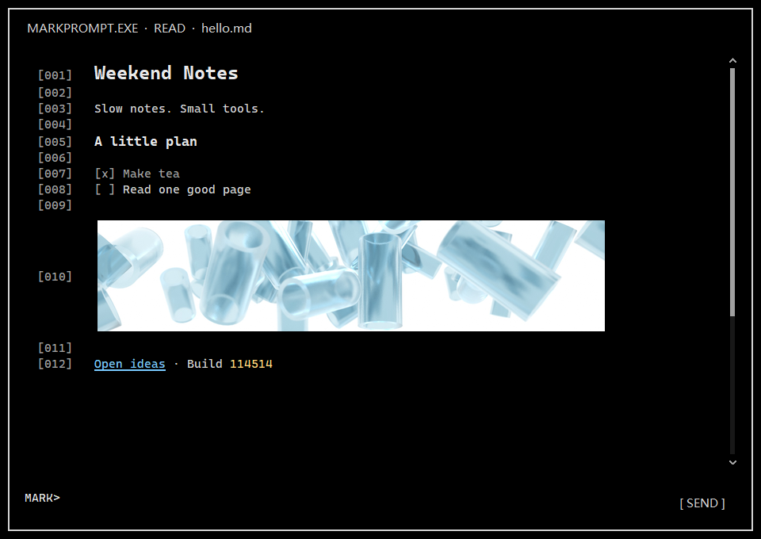
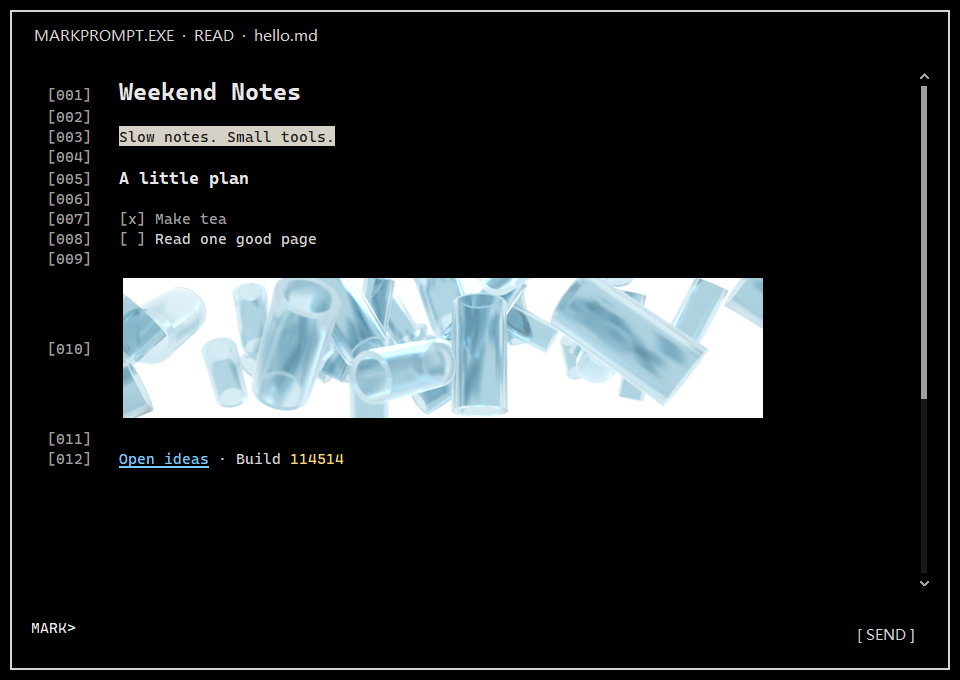
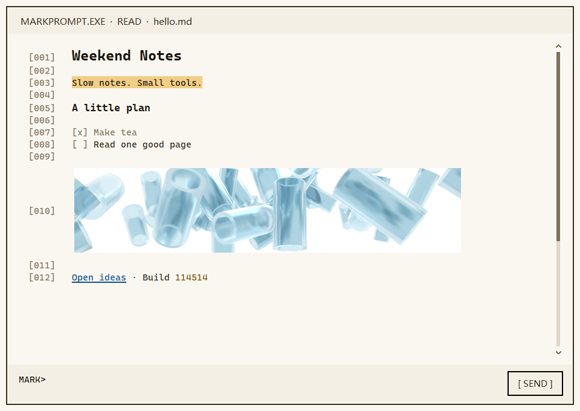

# 📖 MarkPrompt

> *给 Markdown 加一点 DOS 时代的乐趣。*

🌐 [English](README.md) | **简体中文**

[](https://github.com/4044044044/MarkPrompt/releases/latest)
[](LICENSE)
[](https://github.com/4044044044)

**[📦 下载 Windows 免安装版](https://github.com/4044044044/MarkPrompt/releases/latest)**

🎬 搜到 TODO，只把第 7 行的命中改成 DONE，再保存。



[✨ 特性](#features) · [📦 安装](#start) · [🚀 开始](#quickstart) · [📖 示例](#tutorials) · [📋 命令](#commands) · [🤖 CLI](#cli) · [🔨 打包](#build)

---

<a id="features"></a>

## ✨ 特性

一个偏爱 DOS 时代的本地 Markdown 小工具。文字界面、命令提示符、键盘操作，图的就是那份复古的乐趣。读几篇文档、记几条想法，也可以用 CLI 读取笔记，或导出 JSON 快照供 AI 使用。

- 📖 **拖进来就能读** — Markdown、文本、文件夹都可以。
- ✍️ **用命令改笔记** — 连续追加、按行修改、替换、撤销与重做。
- 🔎 **想找什么就搜什么** — 文件名、工作区正文、文内关键词。
- 🗂️ **笔记有个家** — 工作区、目录书签、标签、任务与归档。
- 🖼️ **本地图片直接看** — 支持 PNG、JPG、JPEG，保留原色。
- 🌗 **换个心情继续写** — 暗色 / 亮色主题，中英界面切换。
- 🤖 **也给脚本留个入口** — 独立 CLI、窗口控制与 JSON 快照。

原生 Tkinter 窗口。`.md` 支持命令编辑，`.txt` 只读。支持常用 Markdown 语法，暂不承诺完整 GFM 扩展；图片暂不加载网络地址。二进制或不支持的文件会显示 `Unknown`。



---

<a id="start"></a>

## 📦 安装

### 🪟 Windows 免安装版

1. 打开[最新 Release](https://github.com/4044044044/MarkPrompt/releases/latest)，下载附件中以 `windows-x64.zip` 结尾的文件。
2. 解压，双击 **`MarkPrompt.exe`**。
3. 想在终端使用，就运行 **`MarkPromptCLI.exe`**。

无需另装 Python。包内的第三方许可声明请随程序保留。

### 🐍 从源码启动

在本 README 所在目录打开终端，安装依赖并启动：

```powershell
py -m pip install -r requirements.txt
py markprompt.py
```

Windows 也可以在安装依赖后双击 `markprompt.py`。安装和启动请使用同一个 Python 环境。

🧰 依赖：Python、Tkinter、Pillow、tkinterdnd2。已验证 Windows / Python 3.9.10；其他系统尚未实机验收。没有 `py` 命令时，可替换为对应环境的 `python` 或 `python3`。

---

<a id="quickstart"></a>

## 🚀 快速开始

把笔记文件夹拖进窗口，再依次输入：

```text
/workspace here
/new Hello
/append 今天开始用 MarkPrompt 记笔记。
/save
```

🎉 当前文件夹成为工作区，`Hello.md` 也写好了第一条记录。

拖入文件夹只会进入该目录；`/workspace here` 才会把它设为笔记工作区。正文修改先留在内存，记得 `/save`。

### ⌨️ 常用快捷键

| 按键 | 用途 |
| --- | --- |
| `/` | 聚焦命令输入框 |
| `Enter` | 提交输入 |
| `Tab` | 补全命令 |
| `↑` / `↓` | 候选项导航；输入框为空且未选中文本时滚动 |
| `Ctrl + P` | 按文件名查找 |
| `Ctrl + F` | 文内搜索 |
| `Ctrl + O` | 标题大纲 |
| `F3` / `Shift + F3` | 下一个 / 上一个命中 |
| `Ctrl + S` | 保存 |
| `Ctrl + Z` / `Ctrl + Y` | 撤销 / 重做 |

💡 输入 `/s`，就能看到匹配的命令和用途。



---

<a id="tutorials"></a>

## 📖 使用示例

### ✍️ 例子 1：连续记几条

打开一篇 Markdown，输入 `/append`，接着逐条输入内容：

```text
/append
第一条想法
第二条想法
/end
/save
```

💡 `/append 内容` 只追加一次；单独 `/append` 进入连续追加。`/end` 退出当前模式，不等于保存。



### 🔎 例子 2：找文件，也找关键词

| 想找什么 | 输入示例 |
| --- | --- |
| 文件名带 meeting | `/files meeting` |
| 工作区中提到 deadline 的笔记 | `/find deadline` |
| 当前文档中的 todo | `/search todo` |
| 当前文档中的 todo，不分大小写 | `/search -i todo` |

📂 `/find` 在目录界面使用，文档中先 `/back`。打开命中文档后会自动进入文内搜索并定位；再次 `/back` 可返回原搜索结果和位置。



### 🛠️ 例子 3：搜到以后怎么改

假设第 12 行是 `接口A 调用 接口B`：

```text
/search 接口
/line 12 服务
/save
/end
```

这一行变成 `服务A 调用 服务B`，其他行保持原样。

| 操作 | 普通阅读 | 搜索中 |
| --- | --- | --- |
| `/line 12 内容` | 替换第 12 整行 | 只替换该行命中 |
| `/line delete 12` | 删除第 12 整行 | 只删除该行命中 |
| `/line 12` | 跳到第 12 行 | 把搜索范围限于该行 |
| `/replace 内容` | 需先搜索 | 替换当前范围全部命中 |
| `/delete` | 需先搜索 | 删除当前范围全部命中 |

💾 保存、撤销和重做都会保留搜索状态。重新 `/search 关键词` 可恢复全文搜索；搜索中不能追加，先 `/end` 再 `/append`。每次文内搜索使用一个关键词。

### 🖼️ 例子 4：放入本地图片

图片路径相对于 Markdown 文件，例如：

```text
notes/
├── Hello.md
└── images/
    └── photo.jpg
```

在 `Hello.md` 中写入：

```markdown

[访问网站](https://example.com)
```

图片保留原色。查看文内链接可用 `/external links`，按所在行打开可用 `/external link 行号`。

🧊 示例中的玻璃作品由项目作者原创，展示时作了横幅裁切。



---

<a id="appearance"></a>

## 🌗 两种配色，一本笔记

暗色留一点 DOS 情怀，亮色换一张暖色纸。选中文字时，暗色用纸白，亮色用琥珀。

| 🌑 暗色 | ☀️ 亮色 |
| --- | --- |
|  |  |

---

<a id="commands"></a>

## 📋 命令说明

在窗口底部输入。`<…>` 为必填，`[…]` 为可选；输入时不要带尖括号或方括号。`N` 表示编号。

### 📂 文件与目录

| 命令 | 说明 |
| --- | --- |
| `/open [目标]` | 打开路径、列表编号或书签；无参数进入连续打开 |
| `/workspace <目录或here>` | 设置笔记工作区 |
| `/ls [目录]` | 列出目录内容 |
| `/cd <目录>` | 进入目录 |
| `/up` | 上一级目录 |
| `/tree` | 查看两层目录树 |
| `/back` | 返回上一视图或搜索结果 |
| `/home` | 返回首页 |
| `/pwd` | 显示当前目录 |
| `/files [名称]` | 按文件名查找 |
| `/recent [名称]` | 查看最近打开的文件 |
| `/bookmark [add 名称 [目录]\|list\|remove 名称]` | 添加、查看或移除目录书签 |
| `/new <标题>` | 在工作区新建 Markdown |
| `/jot <标题>` | 新建并进入连续追加 |
| `/import <路径.md>` | 复制 Markdown 到工作区 |
| `/saveas <名称>` | 另存为 |
| `/export txt` | 将当前正文导出为纯文本 |
| `/archive` | 保存并移入工作区归档 |
| `/trash` | 保存并移入工作区回收站 |
| `/restore <名称>` | 从工作区回收站恢复 |
| `/reveal` | 在系统文件管理器中显示所在目录 |

🧭 **目录关键词**

| 输入 | 含义 |
| --- | --- |
| `/open desktop` | 桌面 |
| `/open workspace` 或 `/open ws` | 工作区根目录 |
| `/open @名称` | 对应目录书签 |
| `/open 3` | 当前列表第 3 项 |
| `/workspace here` | 把当前浏览目录设为工作区 |
| `/cd ..` | 父目录 |

`desktop` 是 `/open` 的关键词。要将桌面设为工作区：先 `/open desktop`，再 `/workspace here`。其他目录可直接填写路径。

### ✍️ 编辑与阅读

| 命令 | 说明 |
| --- | --- |
| `/append [内容]` | 追加一次；无参数连续追加 |
| `/line <N> [内容]` | 定位或修改指定行；搜索时仅处理命中 |
| `/line delete <N>` | 删除整行；搜索时仅删除命中 |
| `/title <标题>` | 修改正文一级标题 |
| `/save` | 保存当前修改 |
| `/undo` | 撤销 |
| `/redo` | 重做 |
| `/preview` | 重新渲染预览 |
| `/source` | 查看 Markdown 源文 |
| `/view` | 切换预览与源文 |
| `/outline [N]` | 列出标题或跳到指定标题 |
| `/reload` | 刷新当前文件或目录 |
| `/external [file\|links\|link N [序号]\|open 目标]` | 用系统应用打开当前文件或链接；默认打开文件 |

💡 `/title` 改正文标题；要另存文件用 `/saveas`。源文视图用于阅读，修改仍通过命令完成。

### 🔎 搜索与整理

| 命令 | 说明 |
| --- | --- |
| `/find <关键词>` | 搜索工作区正文，不分大小写 |
| `/search [-i] [关键词]` | 搜当前文档；`-i` 忽略大小写；无词进入搜索模式 |
| `/next` | 下一个命中 |
| `/prev` | 上一个命中 |
| `/replace <内容>` | 替换当前搜索范围全部命中 |
| `/delete` | 删除当前搜索范围全部命中 |
| `/tasks` | 查看工作区未完成任务 |
| `/check <N>` | 切换当前文档第 N 个任务的完成状态，非行号 |
| `/tag [add 标签\|find 标签]` | 查看、添加或查找标签；多个标签用逗号分隔 |
| `/tags` | 查看工作区标签及数量 |

### ⚙️ 模式与设置

| 命令 | 说明 |
| --- | --- |
| `/end` | 退出一层业务模式，恢复上一层 |
| `/status` | 查看当前文件、工作区和模式 |
| `/lang [code]` | 列出可用语言，或切换并记住语言选择 |
| `/theme [dark\|light]` | 查看或切换主题 |
| `/dark` | 暗色主题 |
| `/light` | 亮色主题 |
| `/animation [on\|off]` | 查看或切换动画 |
| `/clear` | 清理命令记录，保留阅读内容 |
| `/snapshot [--full] [文件.json]` | 查看会话数据，可导出 JSON；`--full` 包含完整正文 |
| `/help` | 查看命令帮助 |
| `/quit` | 退出程序 |

🌐 **语言**：没有配置时默认使用英语。`/lang` 列出自动发现的语言；`/lang zh` 切换简体中文，`/lang en` 切换英语。GUI 会在设置中记住选择；独立 CLI 传入 `--config settings.json` 时会保存语言，未指定时仅在当前进程保留。缺少的译文回退到英语。切换语言会保留草稿、搜索和待确认事项。命令名、关键词、JSON 字段与错误代码保持稳定。参见 [语言扩展与翻译贡献](docs/localization.zh-CN.md)。

🔁 **连续模式**：`OPEN>` 连续打开、`FIND>` 工作区搜索、`SEARCH>` 文内搜索、`APPEND>` 连续追加。最多两层，允许 `FIND → OPEN`、`OPEN → APPEND`；用 `/end` 逐层退出。

✅ **确认提示**：按提示输入 `save`（保存）、`discard`（放弃）或 `cancel`（取消）；覆盖确认使用 `y` / `n`。创建、导入、导出、归档和移入回收站等操作会直接涉及磁盘。

⚡ **快捷别名**：`/ws` → `/workspace`，`/bm` → `/bookmark`，`/grep` → `/find`，`/show` → `/preview`，`/?` → `/help`。`/setws` 默认当前目录；`/fsearch 词` 等于 `/search -i 词`；`/linedel N` 等于 `/line delete N`。旧 `/ext` 无参数列出链接，有编号按行打开，其他参数作为外部目标。

---

<a id="cli"></a>

## 🤖 CLI 与 AI

### 🧪 独立运行

把示例中的 `C:\Notes` 换成你的笔记目录。多个 `-c` 在同一个会话中依次执行，修改后仍需 `/save`。

```powershell
# 查看命令能力
py markprompt_cli.py commands --json

# 读取文档与结构化快照
py markprompt_cli.py exec --workspace "C:\Notes" --file "C:\Notes\Hello.md" -c "/snapshot --full" --json

# 追加并保存
py markprompt_cli.py exec --workspace "C:\Notes" --file "C:\Notes\Hello.md" -c "/append Added from CLI." -c "/save" --json

# 保持交互会话并保存语言偏好
py markprompt_cli.py shell --workspace "C:\Notes" --config settings.json
```

📜 批量执行：把命令逐行写入 `workflow.txt`，运行 `py markprompt_cli.py run --workspace "C:\Notes" --script workflow.txt --json`。图形界面相关能力请以 `commands --json` 的结果为准。

### 🪟 连接运行中的窗口

```powershell
py markprompt_cli.py gui windows --json
py markprompt_cli.py gui snapshot --full --json
py markprompt_cli.py gui exec -c "/status" --json
```

多窗口时加 `--window 窗口ID`。快照包含文档、模式、搜索、待确认操作等数据，适合 AI 读取；`--full` 会包含正文，分享前留意内容。

遇到确认，读取快照中的确认 ID，再用 `gui respond --confirmation ID save --json` 回答；也可选 `discard`、`cancel`、`y`、`n`。

📘 详细说明：[CLI](docs/cli.zh-CN.md) · [AI 快照](docs/snapshots.zh-CN.md) · [窗口控制](docs/window-control.zh-CN.md) · [语言扩展](docs/localization.zh-CN.md) · [版本说明](docs/release-notes.zh-CN.md)

---

<a id="build"></a>

## 🔨 编译与打包

以下为 Windows PowerShell 示例，在仓库根目录执行。使用独立虚拟环境打包，可执行文件放入 `dist/`，构建临时文件放入 `build/`。

### ① 🧰 准备环境

```powershell
py -m venv .venv
$buildPython = (Resolve-Path .venv/Scripts/python.exe).Path
$sourceDir = (Get-Location).Path
& $buildPython -m pip install --upgrade pip
& $buildPython -m pip install -r requirements.txt
& $buildPython -m pip install pyinstaller==6.22.3
```

### ② 🖥️ 窗口版

```powershell
& $buildPython -m PyInstaller --clean --onefile --windowed --name MarkPrompt `
  --paths "$sourceDir" --collect-submodules markprompt_core.localization --icon "$sourceDir/MarkPrompt.ico" `
  --add-data "$sourceDir/MarkPrompt.ico:." --add-data "$sourceDir/MarkPrompt.png:." `
  --distpath dist --workpath build/gui --specpath build/spec `
  "$sourceDir/markprompt.py"
```

### ③ ⌨️ 命令行版

```powershell
& $buildPython -m PyInstaller --clean --onefile --console --name MarkPromptCLI `
  --paths "$sourceDir" --collect-submodules markprompt_core.localization --icon "$sourceDir/MarkPrompt.ico" `
  --distpath dist --workpath build/cli --specpath build/spec `
  "$sourceDir/markprompt_cli.py"
```

🌐 语言资源是普通 Python 模块。`--collect-submodules markprompt_core.localization` 会把自动发现的语言模块收进两个可执行文件，无需额外的 JSON 语言文件或运行时依赖。

🎁 输出：`dist/MarkPrompt.exe` 与 `MarkPromptCLI.exe`。

`--onefile` 将运行时和依赖一起打包，因此文件会比源码大。CLI 保留控制台，用于输入和 JSON 输出。其他系统需在对应系统上打包。参数见 [PyInstaller 官方文档](https://pyinstaller.org/en/stable/usage.html)。

### ④ ✅ 发布前

- 🧪 打开生成的窗口版，检查真实文件 / 文件夹拖入、本地 PNG / JPG、搜索编辑和保存。
- 🤖 运行 `MarkPromptCLI.exe commands --json`，再检查一次文档读取和窗口快照。
- 🔐 不要把个人 `markprompt.json` 或笔记放进发布包；配置会在使用时创建。
- 📄 随包保留 [第三方许可](docs/third-party-licenses/README.md)，并补齐所用 Python、Tcl/Tk 和打包运行时的许可声明。

📌 Windows x64 可执行文件已通过本机启动、PNG/JPG 显示、搜索修改保存和 CLI 窗口连接检查。其他平台的构建仍需单独验收。

---

<a id="license"></a>

## 📄 授权与第三方组件

🧊 本项目源码与作者提供的原创示例图片采用 [MIT 许可证](LICENSE)。版权归 2026 MarkPrompt contributors 所有。[作者主页](https://github.com/4044044044)。第三方组件沿用各自许可证。

| 组件 | 版本 | 用途 | 许可证 |
| --- | --- | --- | --- |
| Pillow | 11.3.0 | 解码本地 PNG、JPG 图片 | MIT-CMU |
| tkinterdnd2 | 0.7.0 | 文件与文件夹拖拽 | MIT |

📦 安装依赖见 [requirements.txt](requirements.txt)；完整版权、许可原文与 TkDND 原生组件说明见 [第三方许可](docs/third-party-licenses/README.md)。第三方组件沿用各自许可证。

GitHub 可以识别依赖清单并显示依赖信息；许可声明仍由项目随附。发布源码时通过依赖清单安装，发布可执行文件时还需按实际打包内容附带相应声明。

---

## 🛠️ 遇到问题

| 现象 | 处理 |
| --- | --- |
| 双击没反应 | 在终端运行 `py markprompt.py` 查看错误，并确认依赖装在同一环境 |
| 拖拽没有反应 | 检查 tkinterdnd2；Windows 下让窗口与资源管理器使用相同权限 |
| 图片不显示 | 检查相对路径、文件是否存在，以及是否为本地 PNG / JPG / JPEG |
| 修改没有写入文件 | 执行 `/save`，并检查保存结果 |
| 不确定自己在哪个模式 | 输入 `/status`；用 `/end` 逐层退出 |

---

📷 演示使用 `E:\MPdemo` 中的虚构笔记与独立配置，截图仅保留工具内部界面。

🗓️ 文档更新：**2026-11-01**

*Made with ⌨️ by [MarkPrompt contributors](https://github.com/4044044044)*
